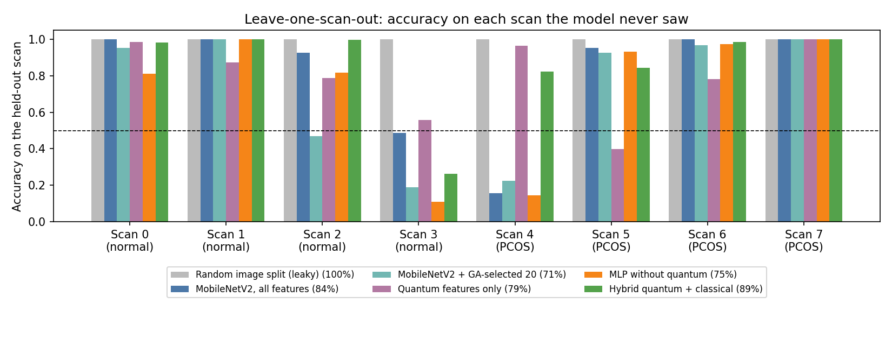
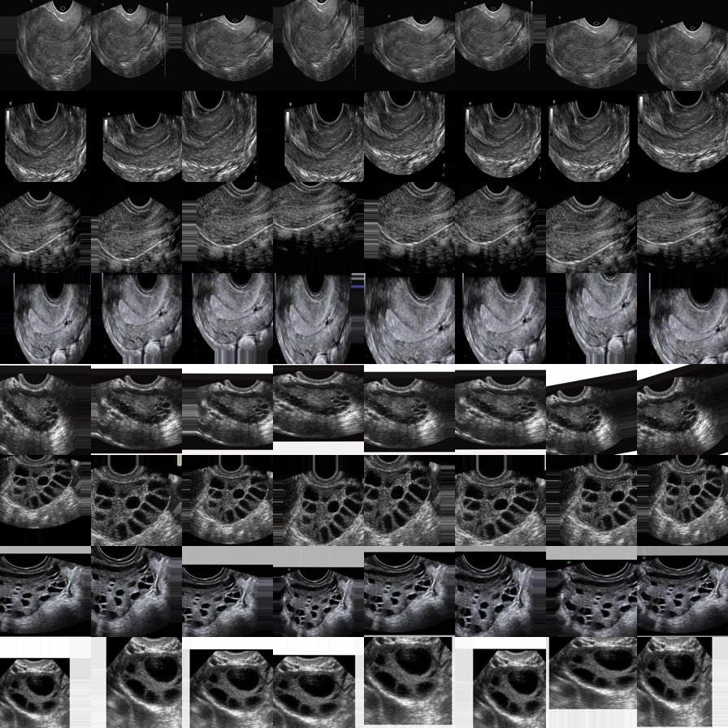

# PCOS-Quantum-Metaheuristic: Hybrid Quantum-Classical PCOS Detection from Ultrasound

Detects **polycystic ovary syndrome (PCOS)** in ovarian ultrasound images by combining a **4-qubit quanvolutional
(quantum convolution) feature extractor**, a **MobileNetV2** transfer-learning backbone and **five metaheuristic
feature selectors** (PSO, GWO, WOA, GA, Firefly). It ships with a Flask web app that compares the quantum and
classical branches side by side.

The project also includes a **data audit**. The popular public dataset turns out to contain only **8 distinct scans**,
so the evaluation here is built around that fact.




---

## Key findings

1. **The dataset is much smaller than it looks.** Of its 3,855 files, 1,925 are byte-identical copies (1,920 of the
   1,922 "test" images also appear in "train") and 9 are empty. The remaining 1,921 images are augmented copies
   (rotated, shifted, zoomed, flipped) of **just 8 original scans: 4 normal and 4 PCOS**.
2. **A random image split gives 100% accuracy, but it only measures memorisation.** Under
   **leave-one-scan-out** evaluation (train on 7 scans, test on the unseen 8th), the same classifier gets 84%.
3. **The quantum features help.** The hybrid model (quantum + classical) reaches **88.6% accuracy / 0.95 ROC-AUC**
   on unseen scans and gets 7 of 8 scans right. The **same network without the quantum branch gets 74.8%**. The
   gain holds on every one of 5 random seeds (87.3 ± 1.9% vs 74.3 ± 2.2%).
4. **Metaheuristic feature selection overfits with this little data.** Selecting 20 of 1,280 features reaches
   ~99% on the training scans, but on unseen scans it does no better than 20 random features. With only 7 training
   scans there isn't enough signal to pick features reliably.

## Pipeline

```
Ultrasound ─► CLAHE contrast enhancement ─┬─► 32×32 gray ─► 4-qubit quanvolution (2×2 patches) ─► 64 quantum features ──┐
                                          │                                                                             ├─► fusion MLP ─► PCOS / normal
                                          └─► 224×224 ─► MobileNetV2 (ImageNet) ─► 1,280 features ─► PSO/GWO/WOA/GA/FA ─┘
                                                                                                     select 20
```

| Step | Script | What it does |
|---|---|---|
| 1 | [`01_prepare_data.py`](01_prepare_data.py) | Removes exact duplicates (MD5), then finds augmented copies with CNN-embedding neighbours + **SIFT/RANSAC** geometric verification, and groups them into source scans |
| 2 | [`02_extract_features.py`](02_extract_features.py) | CLAHE, then MobileNetV2 features, quanvolutional features and a classical control |
| 3 | [`03_loso_evaluation.py`](03_loso_evaluation.py) | **Leave-one-scan-out** evaluation of every model; feature selection runs inside each fold |
| 4 | [`04_train_final.py`](04_train_final.py) | Trains the models served by the web app on all scans |
| 5 | [`05_figures.py`](05_figures.py) | Per-scan results figure |

### The dataset audit


*Each row shows 8 random images from one group found by step 1: every group is one ultrasound scan, augmented
99–391 times. Rows 1–4 are normal and rows 5–8 are PCOS.*

Every candidate pair of look-alike images was checked with SIFT keypoints and a RANSAC homography. Matching copies
share a median of **285 geometrically consistent keypoints**, far above chance. No group mixes the two labels.

## Quantum feature extractor

[`src/quantum_branch.py`](src/quantum_branch.py) implements a **quanvolutional layer** (Henderson et al., 2019). Each
2×2 pixel patch is angle-encoded into 4 qubits with `RY(θ)`, entangled by a ring of CNOTs, and measured as `⟨Z⟩` on
every qubit. Sliding it over a 32×32 image gives a 4-channel 16×16 map, which is pooled to 64 features.

- The reference circuit is written in **PennyLane**. For speed, the same circuit is simulated **exactly with
  vectorised NumPy**, which takes 28 s on CPU for the whole dataset instead of hours.
  [`tests/test_quantum_equivalence.py`](tests/test_quantum_equivalence.py) checks that both give identical outputs.
- Because the input is a product state and the CNOTs only permute basis states, the circuit has a **closed form**
  (verified in the same test):

  `⟨Z₀⟩ = cos θ₁ cos θ₂ cos θ₃`, `⟨Z₁⟩ = cos θ₀ cos θ₁`, `⟨Z₂⟩ = cos θ₀ cos θ₁ cos θ₂`, `⟨Z₃⟩ = cos θ₀ cos θ₁ cos θ₂ cos θ₃`

  So the gain comes from a useful **nonlinear feature map** (products of cosines of pixel intensities) inspired by
  the quantum circuit, not from quantum hardware. A classical control with the same patching and pooling but raw
  pixels gets 64% vs 79% for the quantum features.

## Metaheuristic feature selection

[`src/metaheuristic_opt.py`](src/metaheuristic_opt.py) implements PSO (Kennedy & Eberhart, 1995), GWO
(Mirjalili et al., 2014), WOA (Mirjalili & Lewis, 2016), GA with tournament selection and elitism, and Firefly
(Yang, 2008) as **wrapper feature selectors**. Each agent scores all 1,280 features and keeps the top 20.

- **Fitness:** balanced accuracy of logistic regression in **group-aware 3-fold CV over the training scans only**.
- **Equal budget:** 300 unique fitness evaluations per algorithm.


*GA and GWO reach the highest training fitness. FA's curve is short because each FA iteration compares every pair of
fireflies, so it uses its budget in few iterations.*

## Results: leave-one-scan-out (8 folds, 1,921 images)

| Model | Features | Accuracy | Balanced acc. | ROC-AUC | Unseen scans correct* |
|---|---|---|---|---|---|
| *Random image-level 5-fold CV (leaky, for comparison)* | *1,280* | *100%* | *100%* | *1.000* | *8/8* |
| MobileNetV2, all features + logistic regression | 1,280 | 84.4% | 83.4% | 0.915 | 6/8 |
| MobileNetV2, 20 random features | 20 | 81.9% | 80.3% | 0.875 | 6/8 |
| MobileNetV2 + PSO selection | 20 | 73.7% | 72.6% | 0.811 | 6/8 |
| MobileNetV2 + GWO selection | 20 | 77.4% | 74.3% | 0.759 | 6/8 |
| MobileNetV2 + WOA selection | 20 | 67.9% | 67.5% | 0.732 | 6/8 |
| MobileNetV2 + GA selection | 20 | 71.3% | 72.3% | 0.838 | 5/8 |
| MobileNetV2 + Firefly selection | 20 | 63.6% | 65.2% | 0.754 | 4/8 |
| Classical control (raw 2×2 patches) | 64 | 64.0% | 63.3% | 0.701 | 5/8 |
| **Quantum (quanvolution) features** | 64 | 79.4% | 78.9% | 0.884 | **7/8** |
| Fusion MLP **without** quantum branch | 20 | 74.8% | 75.0% | 0.837 | 6/8 |
| **Hybrid fusion MLP: quantum + selected classical** | 84 | **88.6%** | **89.1%** | **0.949** | **7/8** |

\*A scan counts as correct when the mean predicted probability over all its augmented copies is on the right side
of 0.5. The MLP rows average 5 random seeds. Per-scan numbers are in [`results/loso_per_scan.csv`](results/loso_per_scan.csv).

**How to read these numbers:** with only 8 independent scans, every figure has a wide confidence interval. The
results show which ideas transfer to an unseen scan, but they are not a clinical accuracy estimate.

### Note on earlier results
An earlier version of this project reported **98.9%** accuracy on the dataset's own `test/` folder. That folder is a
copy of `train/`, so the figure reflects memorisation. This version re-evaluates everything on unseen scans.

## Web app

```bash
python app.py        # http://127.0.0.1:5000
```


Upload an ultrasound and choose a selector (PSO / GWO / WOA / GA / FA). The app shows:
- the quantum and the metaheuristic branch predictions with confidence
- leave-one-scan-out metrics for each branch
- a rough outline of dark, round regions (often follicles) on positive cases

The outlines come from **classical image processing (a heuristic visual aid)**, not from the model. Non-grayscale
or blank images are rejected.

## Reproduce

```bash
git clone https://github.com/shubhreeka/PCOS-Quantum-Metaheuristic.git && cd PCOS-Quantum-Metaheuristic
python -m venv venv && venv\Scripts\activate          # macOS/Linux: source venv/bin/activate
pip install -r requirements.txt

# Dataset: "PCOS Detection using Ultrasound Images" (Kaggle), with train/ and test/ folders,
# each containing infected/ and notinfected/
set PCOS_DATA_ROOT=path\to\data                        # macOS/Linux: export PCOS_DATA_ROOT=...

python 01_prepare_data.py       # ~5 min on CPU (SIFT verification)
python 02_extract_features.py   # <1 min
python 03_loso_evaluation.py    # ~10 min
python 04_train_final.py
python 05_figures.py
python tests/test_quantum_equivalence.py   # needs pennylane
```
The dataset and trained models are not stored in this repository.

## Limitations & future work
- **Only 8 independent scans.** External validation on a larger, multi-centre dataset with patient-level metadata is
  the most important next step.
- The quantum circuit is fixed (not trained) and simulated classically. Next steps: trainable variational circuits
  and a run on real quantum hardware.
- Feature selection needs more independent scans to beat random selection. Group-aware stability selection is a
  natural next step.
- **Research prototype, not a medical device.** Predictions must not be used for diagnosis.

## Author

**Shubhreeka Saxena**, B.Tech AI & ML, VIPS-TC (GGSIPU)
[LinkedIn](https://www.linkedin.com/in/shubhreeka-saxena/) · [GitHub](https://github.com/shubhreeka)
